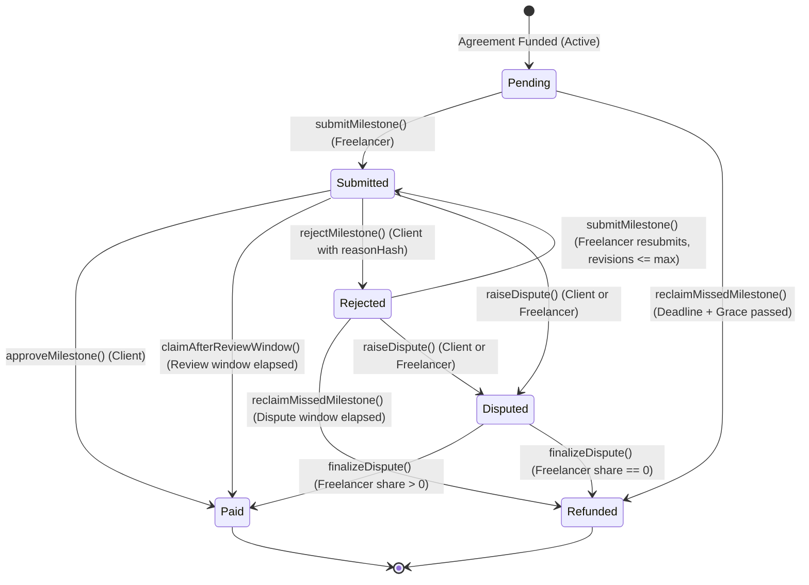
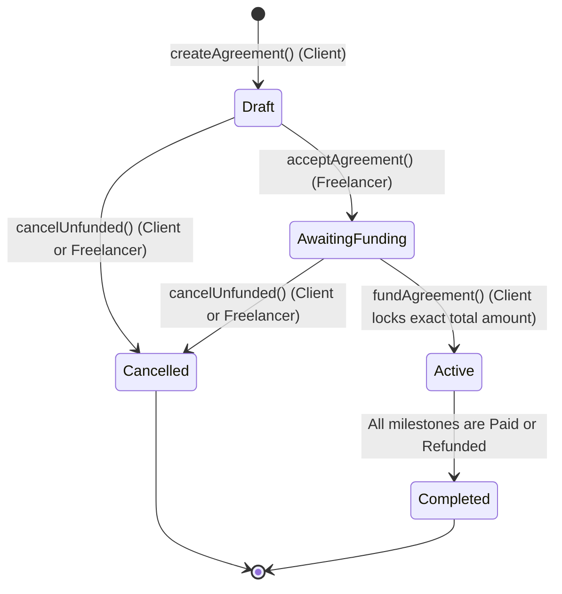

# FairWork Smart Contracts (contracts/)

**Owner:** Person 1 (Yash Naik)  
**Stack:** Solidity `0.8.24`, Hardhat, OpenZeppelin (`ReentrancyGuard`, `Ownable`, `Pausable`), ethers v6, Chai  
**Network Support:** Hardhat Local (`31337`, port `8545`), Polygon Amoy Testnet (`80002`)  
**Currency:** Native currency (MATIC / ETH in wei)

---

## 1. Overview

`FairWork.sol` provides the trustless, milestone-based escrow core for the FairWork freelance platform. It governs off-chain AI analysis integration, on-chain milestone escrow locking, lateness penalty deductions, arbitrator dispute resolution, and verifiable accounting.

All contract outputs are exported into:
- ABI: `shared/abi/FairWork.json`
- Deployments: `shared/deployments/<network>.json` (e.g. `localhost.json`, `polygonAmoy.json`)

---

## 2. State Diagrams

### Milestone Status Lifecycle



### Agreement Status Lifecycle



---

## 3. Smart Contract Function Table

### Write Functions

| Function | Caller | Description | Events Emitted |
| :--- | :--- | :--- | :--- |
| `createAgreement(address freelancer, bytes32 termsHash, string termsURI, PaymentMode mode, uint16 latePenaltyBpsPerDay, uint16 maxLatePenaltyBps, uint32 reviewWindow, uint32 graceWindow, uint8 maxRevisions, uint256[] amounts, uint64[] deadlines, uint16[] requiredProgressBps, bytes32[] criteriaHashes)` | Client | Creates new agreement in `Draft` state. Validates matching array lengths, positive amounts, increasing deadlines, and single milestone if `LUMP_SUM`. | `AgreementCreated(id, client, freelancer, termsHash, termsURI)` |
| `acceptAgreement(uint256 id)` | Freelancer | Accepts agreement terms, transitioning status to `AwaitingFunding`. | `AgreementAccepted(id)` |
| `fundAgreement(uint256 id)` (`payable`) | Client | Funds escrow with `msg.value == sum(amounts)`, transitioning status to `Active`. | `AgreementFunded(id, amount)` |
| `cancelUnfunded(uint256 id)` | Client or Freelancer | Cancels agreement before funding (`Draft` or `AwaitingFunding`). | `AgreementCancelled(id)` |
| `submitMilestone(uint256 id, uint8 idx, bytes32 submissionHash, string commitSha)` | Freelancer | Submits milestone work (from `Pending` or `Rejected` if revisions $\le$ max). Starts review window timer. | `MilestoneSubmitted(id, idx, submissionHash, commitSha)` |
| `recordProgress(uint256 id, uint8 idx, uint16 aiProgressBps, bytes32 aiReportHash)` | Oracle | Records advisory AI progress assessment and report hash for milestone. | `ProgressRecorded(id, idx, aiProgressBps, aiReportHash)` |
| `approveMilestone(uint256 id, uint8 idx)` | Client | Approves milestone, releases payment minus lateness penalty (refunded to client) and platform fee (sent to treasury). | `MilestoneApproved(id, idx, false)`, `MilestonePaid(id, idx, freelancerAmount, fee, penaltyRefund)`, `AgreementCompleted(id)` (if all done) |
| `claimAfterReviewWindow(uint256 id, uint8 idx)` | Freelancer | Auto-claims milestone payout if client remained silent for $\ge$ `reviewWindow`. | `MilestoneApproved(id, idx, true)`, `MilestonePaid(id, idx, freelancerAmount, fee, penaltyRefund)`, `AgreementCompleted(id)` |
| `rejectMilestone(uint256 id, uint8 idx, bytes32 reasonHash)` | Client | Rejects submitted milestone with reason hash. Increments revisions count. | `MilestoneRejected(id, idx, reasonHash)` |
| `reclaimMissedMilestone(uint256 id, uint8 idx)` | Client | Reclaims funds if milestone is `Pending` after `deadline + graceWindow` OR `Rejected` after `rejectionTime + reviewWindow`. | `MilestoneRefunded(id, idx, amount)`, `AgreementCompleted(id)` |
| `proposeAmendment(uint256 id, uint8 idx, uint64 newDeadline, bytes32 newTermsHash, string newTermsURI)` | Client or Freelancer | Proposes amendment to milestone deadline or terms. Recorded in audit history. | `AmendmentProposed(id, idx, amendmentId, proposer, newDeadline, newTermsHash, newTermsURI)` |
| `acceptAmendment(uint256 id, uint256 amendmentId)` | Counterparty | Accepts proposed amendment and applies terms update. | `AmendmentAccepted(id, amendmentId)` |
| `raiseDispute(uint256 id, uint8 idx, bytes32 evidenceHash)` | Client or Freelancer | Freezes milestone funds into `disputed` and pseudo-randomly selects 3 arbitrators. | `DisputeRaised(id, idx, by, evidenceHash)`, `ArbitratorsSelected(id, idx, address[3])` |
| `submitEvidence(uint256 id, uint8 idx, bytes32 evidenceHash)` | Client or Freelancer | Submits additional evidence hash for an active dispute. | `EvidenceSubmitted(id, idx, by, evidenceHash)` |
| `recordAiRecommendation(uint256 id, uint8 idx, uint16 freelancerShareBps, bytes32 reportHash)` | Oracle | Records advisory AI dispute recommendation for fallback resolution. | `AiRecommendationRecorded(id, idx, freelancerShareBps, reportHash)` |
| `castVote(uint256 id, uint8 idx, uint16 freelancerShareBps)` | Selected Arbitrator | Selected arbitrator casts proposed freelancer share (0-10000 bps) within voting window. | `VoteCast(id, idx, voter, freelancerShareBps)` |
| `finalizeDispute(uint256 id, uint8 idx)` | Anyone | Finalizes dispute using MEDIAN of votes ($\ge 2$ votes), AI recommendation fallback, or `aiProgressBps` fallback. Pays freelancer share minus fee, refunds balance to client. | `DisputeResolved(id, idx, freelancerShareBps, method)`, `AgreementCompleted(id)` |

### Admin Functions

| Function | Caller | Description |
| :--- | :--- | :--- |
| `addArbitrator(address arbitrator)` | Owner | Adds an address to the arbitrator pool. |
| `removeArbitrator(address arbitrator)` | Owner | Removes an address from the arbitrator pool. |
| `setOracle(address _oracle)` | Owner | Updates the authorized backend oracle address. |
| `setTreasury(address payable _treasury)` | Owner | Updates the platform treasury wallet. |
| `setFeeBps(uint16 _feeBps)` | Owner | Sets platform fee (max 500 bps = 5.00%, default 100 bps = 1.00%). |
| `pause()` / `unpause()` | Owner | Emergency pause/unpause for write operations. |

### View Functions

| Function | Returns | Description |
| :--- | :--- | :--- |
| `getAgreement(uint256 id)` | `Agreement` struct | Returns all agreement parameters, status, and terms hash. |
| `getMilestone(uint256 id, uint8 idx)` | `Milestone` struct | Returns milestone status, deadline, amount, AI metrics, and submission info. |
| `getMilestoneCount(uint256 id)` | `uint256` | Returns number of milestones in the agreement. |
| `getDispute(uint256 id, uint8 idx)` | Dispute details + `evidenceHashes[]` | Returns dispute timeline, selected arbitrators, vote count, AI recommendation, and resolution status. |
| `getPaymentSummary(uint256 id)` | `(uint256 locked, uint256 released, uint256 disputed, uint256 refunded, uint256 feesPaid)` | Returns exact real-time financial accounting breakdown. |
| `getAmendment(uint256 id, uint256 amendmentId)` | `Amendment` struct | Returns amendment proposal data and acceptance status. |
| `getAmendmentCount(uint256 id)` | `uint256` | Total amendments proposed for an agreement. |
| `getArbitratorPool()` | `address[]` | Returns the list of all registered arbitrators. |

---

## 4. Accounting Invariant & Financial Formulas

### The Invariant
At every block and after every transaction:
$$\text{locked} + \text{released} + \text{disputed} + \text{refunded} + \text{feesPaid} = \text{totalFunded}$$

### Approval / Auto-Claim Payout Math
For a milestone of amount $M$:
1. **Lateness Penalty:**
   $$\text{daysLate} = \begin{cases} \lfloor (\text{submissionTime} - \text{deadline}) / 86400 \rfloor & \text{if } \text{submissionTime} > \text{deadline} \\ 0 & \text{otherwise} \end{cases}$$
   $$\text{penaltyBps} = \min(\text{daysLate} \times \text{latePenaltyBpsPerDay}, \text{maxLatePenaltyBps})$$
   $$\text{penaltyRefund} = \frac{M \times \text{penaltyBps}}{10000}$$
   *(Refunded to client)*

2. **Platform Fee:**
   $$\text{amountAfterPenalty} = M - \text{penaltyRefund}$$
   $$\text{fee} = \frac{\text{amountAfterPenalty} \times \text{feeBps}}{10000}$$
   *(Sent to treasury)*

3. **Freelancer Payout:**
   $$\text{freelancerAmount} = \text{amountAfterPenalty} - \text{fee}$$
   $$\text{freelancerAmount} + \text{fee} + \text{penaltyRefund} \equiv M$$

### Dispute Finalization Payout Math
With resolved freelancer share $S \in [0, 10000]$ basis points:
1. $\text{freelancerGross} = \frac{M \times S}{10000}$
2. $\text{clientPayout} = M - \text{freelancerGross}$ *(Refunded to client)*
3. $\text{fee} = \frac{\text{freelancerGross} \times \text{feeBps}}{10000}$ *(Sent to treasury)*
4. $\text{freelancerPayout} = \text{freelancerGross} - \text{fee}$ *(Sent to freelancer)*
5. $\text{freelancerPayout} + \text{fee} + \text{clientPayout} \equiv M$

---

## 5. Security Architecture

1. **Reentrancy Protection (`ReentrancyGuard`):**
   All payment and state modification entry points (`fundAgreement`, `approveMilestone`, `claimAfterReviewWindow`, `reclaimMissedMilestone`, `finalizeDispute`) implement OpenZeppelin's `nonReentrant` modifier.
2. **Checks-Effects-Interactions (CEI):**
   State variables (`_paymentSummaries`, `milestone.status`, `milestone.paidAmount`) are updated before external `.call{value: ...}("")` transfers occur.
3. **Pausable Emergency Stop (`Pausable`):**
   Contract owner can pause all write interactions if an emergency is detected.
4. **Pseudo-Random Arbitrator Selection:**
   Implemented via Fisher-Yates sampling over `block.prevrandao`, `block.timestamp`, `id`, and `idx` to pick 3 distinct arbitrators excluding the client and freelancer. (Hackathon simplification; see Questions for Team Leader regarding Chainlink VRF).

---

## 6. Deployment & Testing Guide

### Prerequisites
- Node.js $\ge 20$
- npm $\ge 10$

### Setup & Installation
```bash
cd contracts
npm install
```

### Running Tests
Run the comprehensive Chai/Hardhat test suite covering all 10 required business flows + amendments:
```bash
npm test
```

### Local Hardhat Node Deployment
1. Start local Hardhat node on port `8545`:
   ```bash
   npm run node
   ```
2. In another terminal, deploy `FairWork.sol`:
   ```bash
   npm run deploy:local
   ```
   This automatically exports:
   - `shared/abi/FairWork.json`
   - `shared/deployments/localhost.json`

3. Seed demo data (creates 3-milestone agreement with client, freelancer, oracle, and arbitrators):
   ```bash
   npm run seed
   ```

### Polygon Amoy Testnet Deployment
Configure your `.env` (or `shared/.env`):
```env
AMOY_RPC_URL="https://rpc-amoy.polygon.technology"
PRIVATE_KEY="<your-deployer-private-key>"
```

Deploy to Polygon Amoy:
```bash
npm run deploy:amoy
```
This automatically updates `shared/deployments/polygonAmoy.json`.

---

## 7. Questions for Team Leader

1. **Chainlink VRF vs Pseudo-Random Arbitrator Selection:**  
   The current implementation uses `block.prevrandao` and `keccak256` to select 3 distinct arbitrators from the pool. While optimal and gas-efficient for local development and testnet hackathon demos, production deployments should integrate Chainlink VRF v2.5 to provide provably fair, tamper-resistant arbitrator selection.
2. **Dispute Auto-Trigger on Final Rejection:**  
   Currently, when `maxRevisions` is reached and the milestone is rejected, the freelancer may call `raiseDispute()` or the client can reclaim after `reviewWindow`. In a future iteration, should reaching `maxRevisions` automatically transition the milestone to `Disputed`?
3. **ERC-20 Stablecoin Support:**  
   The contract strictly uses native MATIC/ETH escrow per MVP requirements. When extending to USDC/USDT in Phase 2, `SafeERC20` transfers and fee conversions should be integrated into `fundAgreement` and `_processPayout`.
