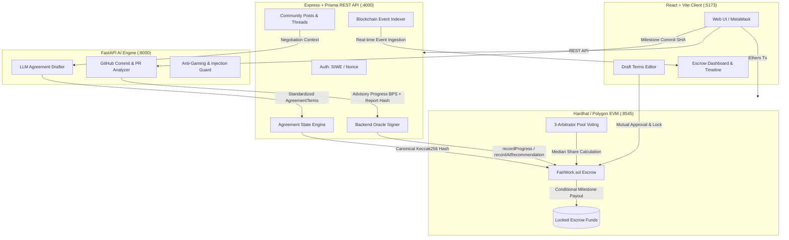

# FairWork ⚡
> **Decentralized Freelance Agreement Platform with AI Progress Tracking & Milestone Escrow**

FairWork bridges off-chain developer activity and on-chain escrow contracts. Freelancers and clients discover each other in a community hub, draft agreements from chat using an AI assistant, bind their terms with deterministic cryptographic hashes, lock milestone funds in non-custodial smart contracts, track development progress via advisory AI analysis of GitHub commits, and resolve disputes through decentralized multi-party arbitration.

---

## 🏗️ Architecture



---

## 🚀 One-Command Quick Start

### Prerequisites
- Node.js (v18+) & `npm`
- Python 3.10+ (with `uvicorn` and `pip`)

### Option A: Windows PowerShell Script
Run the automated initialization script (starts services in order and performs health-check polling):
```powershell
.\scripts\dev-up.ps1
```

### Option B: Bash Script (Linux/macOS)
```bash
chmod +x ./scripts/dev-up.sh
./scripts/dev-up.sh
```

### Option C: Root NPM Script
To run all 4 services concurrently in your terminal:
```bash
# 1. Install all dependencies across all projects
npm run install:all

# 2. Deploy contracts and perform one-time setup
npm run deploy
npm run setup

# 3. Start stack concurrently (Hardhat, AI Service, Backend, Frontend)
npm run dev
```

---

## 🔌 Service Ports & URLs

| Service | Port | Endpoint / Health Check | Purpose |
| :--- | :---: | :--- | :--- |
| **Blockchain** | `8545` | `http://127.0.0.1:8545` | Hardhat local EVM node |
| **AI Service** | `8000` | `http://localhost:8000/health` | FastAPI terms synthesizer & GitHub analyzer |
| **Backend API**| `4000` | `http://localhost:4000/api/health`| Express + Prisma relational DB & oracle |
| **Frontend UI** | `5173` | `http://localhost:5173` | React + Vite freelance dashboard & DApp |

---

## 🔑 Demo Accounts & Wallets

Pre-funded Hardhat development accounts for local MetaMask testing:

| Role | Account Index | Address | Private Key |
| :--- | :---: | :--- | :--- |
| **Contract Owner** | #0 | `0xf39Fd6e51aad88F6F4ce6aB8827279cffFb92266` | `0xac0974bec39a17e36ba4a6b4d238ff944bacb478cbed5efcae784d7bf4f2ff80` |
| **Client** | #1 | `0x70997970C51812dc3A010C7d01b50e0d17dc79C8` | `0x59c6995e998f97a5a0044966f0945389dc9e86dae88c7a8412f4603b6b78690d` |
| **Freelancer** | #2 | `0x3C44CdDdB6a900fa2b585dd299e03d12FA4293BC` | `0x5de4111afa1a4b94908f83103eb1f1706367c2e68ca870fc3fb9a804cdab365a` |
| **Oracle Wallet** | #3 | `0x90F79bf6EB2c4f870365E785982E1f101E93b906` | `0x7c852118294e51e653712a81e05800f419141751be58f605c371e15141b007a6` |
| **Treasury** | #4 | `0x15d34AAf54267DB7D7c367839AAf71A00a2C6A65` | `0x47e179ec197488593b187f80a00eb0da91f1b9d0b13f8733639f19c30a34926a` |
| **Arbitrator 1** | #5 | `0x9965507D1a55bcC2695C58ba16FB37d819B0A4dc` | `0x8b3a350cf5c34c9194ca85829a2df0ec3153be0318b5e2d3348e872092edffba` |
| **Arbitrator 2** | #6 | `0x976EA74026E726554dB657fA54763abd0C3a0aa9` | `0x92db14e403b83dfe3df233f83dfa3a0d7096f21ca9b0d6d6b8d88b2b4ec1564e` |
| **Arbitrator 3** | #7 | `0x14dC79964da2C08b23698B3D3cc7Ca32193d9955` | `0x4bbbf85ce3377467afe5d46f804f221813b2bb87f24d81f60f1fcdbf7cbf4356` |
| **Arbitrator 4** | #8 | `0x23618e81E3f5cdF7f54C3d65f7FBc0aBf5B21E8f` | `0xdbda1821b80551c9d65939329250298aa3472ba22feea921c0cf5d620ea67b97` |
| **Arbitrator 5** | #9 | `0xa0Ee7A142d267C1f36714E4a8F75612F20a79720` | `0x2a871d0798f97d79848a013d4936a73bf4cc922c825d33c1cf7073dff6d409c6` |

---

## 🧪 Testing Guide

Run the individual test suites or the entire end-to-end integration suite:

```bash
# Run all unit test suites across all 4 projects
npm run test:all

# Run individual subproject test suites:
# Smart Contracts (12 unit tests)
npm --prefix "PERSON1 YASH NAIK/contracts" test

# Backend API (26 unit tests)
npm --prefix "PERSON2 DHRUV/backend" test

# AI Service (30 pytest tests)
cd "PERSON3 YASHDEEP" && pytest

# Frontend Unit Tests (8 Vitest tests)
npm --prefix "PERSON4 SUZAN" test

# End-to-End Suite S1-S12 (12 end-to-end scenarios with EVM time travel)
npm run e2e
```

---

## ⚠️ Known Limitations & Design Decisions

1. **GitHub AI Analysis is Advisory**:
   The AI evaluation score recorded by the Oracle is purely advisory. To prevent smart contract deadlock in cases of LLM hallucination or GitHub API outages, the client retains full authority to approve or reject a milestone regardless of the reported score.
2. **Pseudo-Random Arbitrator Selection**:
   In local development, the 3 arbitrators for each dispute are chosen using a pseudo-random block hash formula (`block.prevrandao`). The planned production upgrade path will utilize Chainlink VRF for verifiable randomness.
3. **Native Currency Escrow**:
   The current protocol operates in native currency (`MATIC` / `ETH`). ERC-20 token support (e.g., `USDC`) is architected as an upcoming module extension.