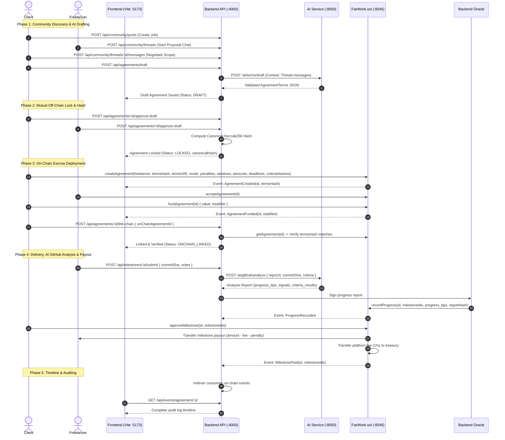

# FairWork System Architecture & Data Flow

This document details the multi-tier architectural design of the **FairWork** monorepo, delineating component boundaries, inter-service communications, state lifecycles, and data synchronization between off-chain databases and the on-chain smart contract.

---

## 1. System Overview

FairWork is composed of four decoupled subsystems cooperating over well-defined seams:

1. **Smart Contracts (`PERSON1 YASH NAIK/contracts`)**:
   - `FairWork.sol` deployed on EVM (Hardhat / Polygon PoS).
   - Manages non-custodial milestone escrow, fee accounting, penalty formulas, and multi-signature arbitrator voting.
2. **Backend API (`PERSON2 DHRUV/backend`)**:
   - Express + TypeScript + Prisma ORM with SQLite (development) / PostgreSQL (production).
   - Manages authentication (SIWE nonces), community feed, chat messaging, agreement state machines, and blockchain indexing.
   - Hosts the **Oracle Signer Wallet** for transmitting verified AI progress data to the smart contract.
3. **AI Service (`PERSON3 YASHDEEP`)**:
   - FastAPI + Python 3.10 + LangChain / OpenAI API.
   - Analyzes community discussion threads to synthesize canonical `AgreementTerms` JSON documents.
   - Inspects target GitHub repositories (commits, PRs, files, CI tests) to compute objective delivery progress.
4. **Frontend Client (`PERSON4 SUZAN`)**:
   - React 18 + Vite + Tailwind CSS + Ethers.js v6.
   - Provides web interface for wallet authentication, community engagement, terms review, contract creation, and timeline inspection.

---

## 2. End-to-End Data Flow

---

## 3. Communication Seams & Protocols

### 3.1 Backend <-> AI Service
- **Transport**: REST JSON over HTTP (`http://localhost:8000`).
- **Security**: Mandatory `X-Internal-Key` header verified by FastAPI dependency.
- **Endpoints**:
  - `POST /ai/terms/draft`: Generates standardized terms document from chat and post context.
  - `POST /ai/github/analyze`: Inspects GitHub repository commits, PRs, and CI tests against acceptance criteria.
  - `POST /ai/dispute/evaluate`: Evaluates evidence submissions during active disputes.
  - `POST /ai/terms/validate`: Validates syntax and schema constraints of user-edited terms.

### 3.2 Frontend <-> Backend
- **Transport**: REST JSON over HTTP (`http://localhost:4000/api`).
- **Security**: JWT bearer token issued after MetaMask personal signature verification (`FairWork login: <nonce>`).
- **CORS**: Explicitly allowed for `http://localhost:5173`.
- **Endpoints**:
  - `/api/auth/*`: Nonce issuance, signature recovery, and session profile.
  - `/api/community/*`: Posts, proposals, discussion threads, and negotiation messages.
  - `/api/agreements/*`: Draft creation, manual editing, mutual approval lock, and on-chain linking.
  - `/api/milestones/*`: Milestone submission metadata and client reviews.
  - `/api/events/*`: Indexed blockchain event logs for chronological audit rendering.
  - `/api/payments/*`: Summary of locked, released, disputed, and refunded balances.

### 3.3 Backend <-> Smart Contract (Oracle Service)
- **Transport**: JSON-RPC over HTTP (`http://127.0.0.1:8545`).
- **Signer**: Oracle wallet funded with private key configured in backend `.env` (`ORACLE_PRIVATE_KEY`).
- **Methods Invoked**:
  - `recordProgress(uint256 id, uint8 idx, uint16 aiProgressBps, bytes32 aiReportHash)`
  - `recordAiRecommendation(uint256 id, uint8 idx, uint16 freelancerShareBps, bytes32 aiReportHash)`

### 3.4 Smart Contract <-> Dispute Arbitrators
- **Dispute Escalation**: Either party calls `raiseDispute(id, idx, evidenceHash)` after rejection.
- **Arbitrator Pool**: 3 arbitrators selected pseudo-randomly from registered pool.
- **Voting Window**: Arbitrators inspect evidence hashes and cast share percentages (`castVote(id, idx, shareBps)`).
- **Finalization**:
  - If `>= 2` votes cast: **Median** of arbitrator votes is executed.
  - If `< 2` votes cast upon timeout: **AI recommendation** recorded by the Oracle is automatically executed.
  - If no AI recommendation: Milestone's last reported AI progress score is utilized as ultimate fallback.
