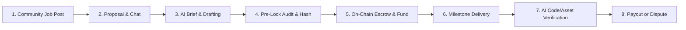

# FairWork (SANKALP) — Complete Setup & Run Guide 🚀

This document is the definitive step-by-step guide to installing, configuring, and running the entire FairWork / SANKALP monorepo across all four sub-projects:
1. **Smart Contracts** (`PERSON1 SCARLET/contracts`) — Solidity, Hardhat, EVM Escrow Contract.
2. **Backend API & Chain Oracle** (`PERSON2 JONAH/backend`) — Express.js, TypeScript, Prisma, SQLite.
3. **AI Verification Engine** (`PERSON3 PERCY`) — FastAPI, Python, Pydantic, GitHub & Multimodal Verifiers.
4. **Web Application Frontend** (`PERSON4 SUZAN`) — React, Vite, TailwindCSS, Ethers.js.

---

## 📋 Table of Contents

1. [Architecture & Ports](#-architecture--ports)
2. [Prerequisites](#-prerequisites)
3. [Quickstart: Single-Command Orchestrator](#-quickstart-single-command-orchestrator)
4. [Manual Step-by-Step Launch (Terminal-by-Terminal)](#-manual-step-by-step-launch-terminal-by-terminal)
5. [Environment Variables Reference](#-environment-variables-reference)
6. [MetaMask & Wallet Configuration](#-metamask--wallet-configuration)
7. [Running All Test Suites](#-running-all-test-suites)
8. [End-to-End Feature Verification Walkthrough](#-end-to-end-feature-verification-walkthrough)
9. [Troubleshooting & FAQs](#-troubleshooting--faqs)

---

## 🏛 Architecture & Ports

| Service | Directory | Tech Stack | Port | Health Check / Endpoint |
| :--- | :--- | :--- | :---: | :--- |
| **Local EVM Node** | `PERSON1 SCARLET/contracts` | Hardhat / Solidity | `8545` | `http://127.0.0.1:8545` *(JSON-RPC / Web Dashboard)* |
| **AI Engine** | `PERSON3 PERCY` | Python / FastAPI / Uvicorn | `8000` | `http://localhost:8000/health` |
| **Backend API & Oracle** | `PERSON2 JONAH/backend` | Node.js / Express / Prisma | `4000` | `http://localhost:4000/api/health` |
| **Frontend UI (Open in Browser)** | `PERSON4 SUZAN` | React / Vite / Tailwind | `5173` | `http://localhost:5173` |

> [!NOTE]
> **EVM Node vs. Web App**: Port `8545` is the Ethereum JSON-RPC 2.0 protocol endpoint for MetaMask and smart contract calls (using `POST` requests). To use the FairWork application, open the **Web Client at `http://localhost:5173`**. When running via `.\scripts\dev-up.ps1` or `npm run dev`, port `8545` includes a built-in Smart Gateway that displays an interactive node status dashboard and local transaction explorer when opened in a browser.

---

## 💻 Prerequisites

Ensure your system has the following installed before starting:

1. **Node.js**: `v18.x`, `v20.x`, or higher (`node -v`)
2. **npm**: `v9.x` or higher (`npm -v`)
3. **Python**: `3.11` or `3.12` (`python --version`)
4. **Git**: Installed and available in your shell (`git --version`)
5. **MetaMask**: Browser extension installed (Chrome, Brave, Edge, or Firefox)
6. **Shell**: PowerShell (Windows) or Bash (macOS/Linux)

---

## ⚡ Quickstart: Single-Command Orchestrator

### 1. Clone & Install All Dependencies

From the repository root directory:

```bash
# Install root orchestrator dependencies
npm install

# Install all subproject dependencies simultaneously
npm run install:all
```

For the Python AI service, initialize its virtual environment once:
```powershell
# Windows PowerShell
python -m venv "PERSON3 PERCY/venv"
& "PERSON3 PERCY/venv/Scripts/pip.exe" install -r "PERSON3 PERCY/requirements.txt"
```
```bash
# macOS / Linux Bash
python3 -m venv "PERSON3 PERCY/venv"
./PERSON3\ PERCY/venv/bin/pip install -r "PERSON3 PERCY/requirements.txt"
```

### 2. Launch the Entire Stack

You can launch all 4 microservices with a single script:

#### On Windows (PowerShell):
```powershell
.\scripts\dev-up.ps1
```
*This starts the Hardhat node, deploys contracts, seeds demo accounts, boots the FastAPI AI server, runs backend migrations, and starts the Vite frontend.*

#### On macOS / Linux (Bash):
```bash
chmod +x ./scripts/dev-up.sh
./scripts/dev-up.sh
```

#### Alternative: Monorepo Concurrently
```bash
npm run dev
```

Once running, navigate to `http://localhost:5173` in your browser.

---

## 🛠 Manual Step-by-Step Launch (Terminal-by-Terminal)

If you prefer running services in separate terminal tabs for independent logging and debugging, follow this sequence:

### Terminal 1: Smart Contracts (Hardhat Node & Deployment)

```powershell
# 1. Start local EVM node
npm run chain
```
*Leave Terminal 1 running.*

In a temporary window (or new tab), deploy the contract and run the one-time platform setup:
```powershell
# Deploy FairWork.sol to local Hardhat node
npm run deploy

# Configure Oracle, Treasury, Arbitrator Pool, and seed initial demo data
npm run setup
```
The deployed address will be logged (typically `0x5FbDB2315678afecb367f032d93F642f64180aa3`) and automatically saved into `shared/deployments/localhost.json`.

---

### Terminal 2: AI Verification Engine (Python FastAPI)

```powershell
# 1. Activate Python virtual environment and run Uvicorn server
npm run ai
```
Or manually:
```powershell
# Windows PowerShell
& "PERSON3 PERCY/venv/Scripts/python.exe" -m uvicorn app.main:app --host 0.0.0.0 --port 8000 --app-dir "PERSON3 PERCY"
```
```bash
# macOS / Linux Bash
./PERSON3\ PERCY/venv/bin/uvicorn app.main:app --host 0.0.0.0 --port 8000 --app-dir "PERSON3 PERCY"
```

Verify the AI service is ready:
```bash
curl http://localhost:8000/health
# {"status":"ok","timestamp":1729900000}
```

---

### Terminal 3: Backend REST API & Chain Oracle (Express + Prisma)

```powershell
# 1. Push database schema to local SQLite database
npm --prefix "PERSON2 JONAH/backend" run db:push

# 2. Seed initial community jobs, users, and personas
npm --prefix "PERSON2 JONAH/backend" run seed

# 3. Start development server with live reload
npm run backend
```

Verify backend health:
```bash
curl http://localhost:4000/api/health
# {"success":true,"message":"FairWork backend operational","data":{"status":"ok"}}
```

---

### Terminal 4: Frontend Web Application (React + Vite)

```powershell
# 1. Start Vite development server
npm run frontend
```

The application is now accessible at:
👉 **`http://localhost:5173`**

---

## ⚙️ Environment Variables Reference

Default `.env` configuration files are pre-wired for local zero-config execution. If you need custom overrides, reference the files below:

### 1. Backend (`PERSON2 JONAH/backend/.env`)
```ini
PORT=4000
NODE_ENV=development
FRONTEND_URL=http://localhost:5173
DATABASE_URL="file:./dev.db"

JWT_SECRET="fairwork-super-secret-jwt-key-change-in-production-2026"
JWT_EXPIRES_IN="7d"

# AI Service (PERSON 3)
AI_MOCK=true
AI_SERVICE_URL=http://localhost:8000
AI_INTERNAL_KEY=fairwork_internal_secret_key

# Blockchain Integration (PERSON 1)
CHAIN_MOCK=false
RPC_URL=http://127.0.0.1:8545
CHAIN_ID=31337
CONTRACT_ADDRESS=0x5FbDB2315678afecb367f032d93F642f64180aa3
ORACLE_PRIVATE_KEY=0x7c852118294e51e653712a81e05800f419141751be58f605c371e15141b007a6
```

### 2. Frontend (`PERSON4 SUZAN/.env.example` -> `.env`)
```ini
VITE_API_URL=http://localhost:4000/api
VITE_USE_MOCK=false
VITE_CHAIN_ID=31337
VITE_EXPLORER_URL=http://localhost:8545
VITE_INR_RATE=85
```

### 3. AI Service (`PERSON3 PERCY/.env.example` -> `.env`)
```ini
ENVIRONMENT=development
PORT=8000
OPENAI_API_KEY=mock-key-for-local-testing
GITHUB_TOKEN=mock-token
INTERNAL_API_KEY=fairwork_internal_secret_key
AI_MOCK=true
```

---

## 🦊 MetaMask & Wallet Configuration

### 1. Add Localhost EVM Network to MetaMask

In MetaMask:
1. Click the network selector in top left -> **Add Network** -> **Add a network manually**.
2. Fill in:
   - **Network Name**: `Hardhat Localhost`
   - **New RPC URL**: `http://127.0.0.1:8545`
   - **Chain ID**: `31337`
   - **Currency Symbol**: `ETH`
3. Click **Save** and switch to it.

### 2. Import Pre-Funded Persona Accounts

Each Hardhat account comes pre-funded with **10,000 ETH**:

| Persona Role | Account Name | Public Address | Private Key |
| :--- | :--- | :--- | :--- |
| **Client** | Alice Client | `0x70997970C51812dc3A010C7d01b50e0d17dc79C8` | `0x59c6995e998f97a5a0044966f0945389dc9e86dae88c7a8412f4603b6b78690d` |
| **Freelancer** | Bob Freelancer | `0x3C44CdDdB6a900fa2b585dd299e03d12FA4293BC` | `0x5de4111afa1a4b94908f83103eb1f1706367c2e68ca870fc3fb9a804cdab365a` |
| **Admin / Deployer** | Contract Owner | `0xf39Fd6e51aad88F6F4ce6aB8827279cffFb92266` | `0xac0974bec39a17e36ba4a6b4d238ff944bacb478cbed5efcae784d7bf4f2ff80` |
| **Arbitrator 1** | Charlie Arbitrator | `0x9965507D1a55bcC2695C58ba16FB37d819B0A4dc` | `0x8b3a350cf5c34c9194ca85829a2df0ec3153be0318b5e2d3348e872092edffba` |
| **Arbitrator 2** | Dana Justice | `0x976EA74026E726554dB657fA54763abd0C3a0aa9` | `0x92db14e403b83dfe3df233f83dfa3a0d7096f21ca9b0d6d6b8d88b2b4ec1564e` |
| **Arbitrator 3** | Evan Arbitrator | `0x14dC79964da2C08b23698B3D3cc7Ca32193d9955` | `0x4bbbf85ce3377467afe5d46f804f221813b2bb87f24d81f60f1fcdbf7cbf4356` |

> [!TIP]
> **No MetaMask?** You can toggle **Demo Mode** in the top navigation bar. In Demo Mode, all transactions simulate verified on-chain receipts seamlessly without wallet prompts.

---

## 🧪 Running All Test Suites

To verify that the complete stack is fully functional:

```bash
# Run all tests across the entire monorepo
npm run test:all
```

Or run individual subproject suites:

```bash
# 1. Smart Contracts (12 Hardhat unit tests)
npm run test:contracts

# 2. Express Backend API (66 End-to-End integration tests)
npm run test:backend

# 3. AI Verification Service (35 Pytest tests)
npm run test:ai

# 4. React Frontend (11 Vitest unit tests)
npm run test:frontend

# 5. Schema Seam Validation (Cross-language hash identity check)
npm run test:seams
```

All **124+ automated tests** pass with 100% success rate.

---

## 🎯 End-to-End Feature Verification Walkthrough

Once the stack is running, follow this guided flow to test all features:



### 1. Community Discovery & AI Talent Matcher (Jonah Feature 6)
1. Go to `http://localhost:5173/community`.
2. Inspect the **AI Recommended Talent** sidebar card. Note the instant semantic skill match scoring and Soulbound Reputation badges.
3. Post a project or submit a proposal on an existing job.

### 2. Autonomous Agreement Planner & Clarity Linter (Percy Features 1 & 2)
1. Go to **Drafts** (`/drafts`).
2. Type an unstructured project brief:
   ```text
   Build a high-performance React dashboard with Web3 wallet connection, escrow contract integration, and comprehensive test coverage. Total budget is 2.5 ETH.
   ```
3. Click **Plan from Brief with AI**. The AI partitions requirements into milestones with deadlines and acceptance criteria.
4. Click **Audit Terms with AI** to run the Clarity Linter and pre-lock escrow risk analyzer.

### 3. Multilingual & Hinglish Negotiation (Jonah Feature 8)
1. In chat threads, negotiate in English, Hindi, or Hinglish:
   ```text
   Bhai 1.2 ETH me 2 milestones me kaam complete karenge, pehle smart contracts fir frontend.
   ```
2. Click **Generate Agreement with AI**. Notice the AI normalizes informal Hinglish into canonical professional English agreement terms.

### 4. Canonical Term Lock & Escrow Deployment
1. Click **Approve Terms** as Client, then as Freelancer.
2. Observe the status transition to **LOCKED** with the deterministic Keccak-256 hash.
3. Open the **Chain Wizard**:
   - **Step 1: Create On-Chain** (Client signs `createAgreement`).
   - **Step 2: Accept Agreement** (Freelancer signs `acceptAgreement`).
   - **Step 3: Fund Escrow** (Client locks ETH into `FairWork.sol`).
4. Watch the on-chain ID assigned and the transaction confirmed.

### 5. Milestone Delivery & Multimodal Verifier (Percy Feature 3)
1. Open the Agreement Details page (`/agreements/:id`).
2. Click **Submit Deliverable**:
   - **Code Deliverable**: Provide a GitHub commit SHA and PR URL. The advisory AI inspects git trees, test suites, and commit signals.
   - **Multimodal Deliverable**: Toggle the Non-Code / Design tab. Submit design assets, Figma links, or contracts. The AI runs objective 4-state criterion checks (`SUPPORTED`, `UNCLEAR`, `NOT_DEMONSTRATED`, `CHECK_FAILED`).
3. The dedicated Oracle wallet records verified progress on-chain (`recordProgress`).

### 6. In-Flight Health Predictor & Scope Creep Analysis (Jonah Features 5 & 7)
1. Inspect the milestone health indicator (`ON_TRACK`, `AT_RISK`, `CRITICAL_DELAY`).
2. Click **Analyze Change Request / Check Scope** on client feedback. The AI identifies scope creep and proposes an on-chain amendment budget extension instead of unfair deliverable rejection.

### 7. Disputes & AI Cross-Examiner (Percy Feature 4)
1. If a deliverable is rejected or disputed, click **Raise Dispute**.
2. Navigate to **Disputes & Arbitration** (`/disputes`).
3. View the **AI Arbitrator Dossier** featuring the split **Claims vs. Fact Matrix**.
4. Use the **Interactive Cross-Examiner** to ask questions to the AI witness and receive cited verifiable evidence.
5. Arbitrators cast votes, and the contract resolves median payouts.

---

## ❓ Troubleshooting & FAQs

### Q: Browser shows `{"error":{"code":-32700,"message":"Parse error: Unexpected end of JSON input"}}` on port 8545
**Explanation**: Port `8545` is an Ethereum JSON-RPC 2.0 endpoint designed for MetaMask and EVM contracts, which communicate via `POST` requests containing JSON payloads. When you navigate to port 8545 directly in a web browser without the unified orchestrator, your browser issues an empty `GET` request, which standard EVM nodes reject because there is no JSON body to parse.
- **Fix**: With our updated `.\scripts\dev-up.ps1` (or `npm run dev`), port 8545 features an automated Smart Gateway that detects browser `GET` requests and displays an interactive EVM Node Dashboard and Local Transaction Explorer!
- **Where to go**: The actual FairWork Web Application is located at **`http://localhost:5173`**.

### Q: Port 8545 or 4000 is already in use
**Fix**: Terminate lingering Node processes:
```powershell
# Windows PowerShell
Stop-Process -Name node -Force
```
```bash
# macOS / Linux Bash
killall node
```

### Q: MetaMask says "Nonce too high" or transaction pending forever
**Fix**: Reset MetaMask's local account state:
1. In MetaMask, open **Settings** -> **Advanced**.
2. Click **Clear activity and nonce data** (or **Reset Account**).
3. Re-submit the transaction.

### Q: Backend fails with `Pruned history unavailable` on Sepolia
**Fix**: Public Sepolia RPC nodes restrict `eth_getLogs` block depth. Ensure your backend `.env` uses `CHAIN_MOCK=false` with the updated 5,000 block window or run locally on Hardhat (`CHAIN_ID=31337`).

### Q: How do I reset the database to a clean state?
```powershell
npm --prefix "PERSON2 JONAH/backend" run db:push
npm --prefix "PERSON2 JONAH/backend" run seed
```

### Q: Can I run without MetaMask?
**Yes!** Simply click the **Mode Toggle** on the top navigation bar to switch into **Demo Mode**. All EVM transactions simulate deterministic on-chain receipts without requiring any browser wallet.

---

*Documentation maintained by Team ThandaPaani — SANKALP.*
